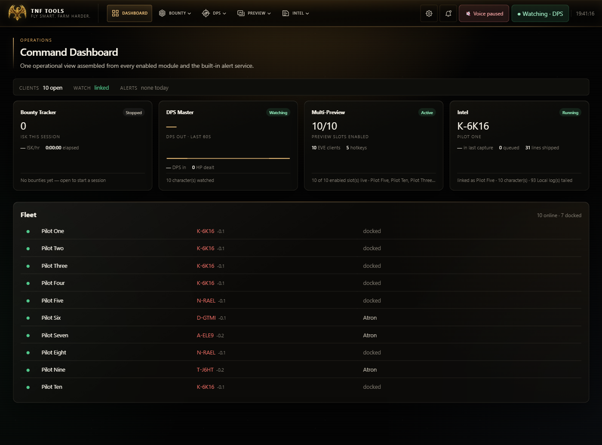
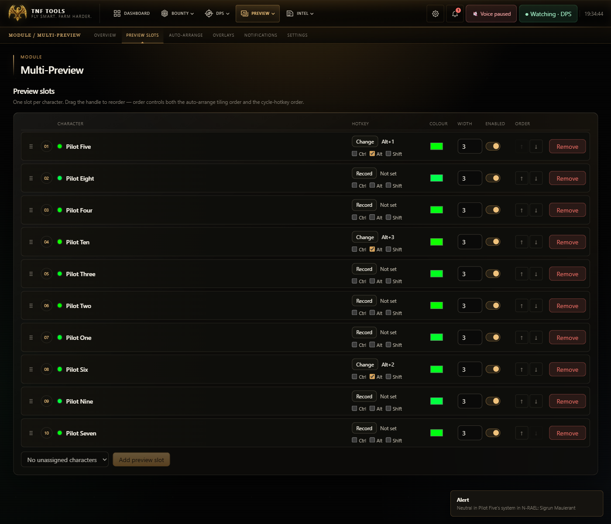

# TNF Tools

A Windows desktop companion for **EVE Online** multiboxing. It shows a live thumbnail of every
client you have open, tracks bounty income and combat performance from your own log files,
and turns the things that matter in those logs into alerts you can hear and see.



| | |
|---|---|
| **Platform** | Windows 10 / 11, 64-bit |
| **Latest version** | See [Releases](../../releases/latest) |
| **Documentation** | [docs/](docs/README.md) |
| **What it reads and sends** | [Privacy and data](docs/privacy.md) |
| **Licence** | Proprietary, limited release. See [LICENSE](LICENSE) |

This repository holds the installers and the documentation. It contains no source code.

## What it does

| Module | In one line | Guide |
|---|---|---|
| **Dashboard** | One screen for every module's state, and where each of your characters is | [Dashboard](docs/dashboard.md) |
| **Multi-Preview** | A live thumbnail of each client; click one, or press its hotkey, to switch to it | [Multi-Preview](docs/multi-preview.md) |
| **Bounty Tracker** | Session ISK, ISK per hour, per-character totals, ESS payouts, and history | [Bounty Tracker](docs/bounty-tracker.md) |
| **DPS Master** | Damage in and out, hit quality, per-target breakdowns, and in-game KPI cards | [DPS Master](docs/dps-master.md) |
| **Alerts** | 27 log-driven alerts, routed by priority to voice, desktop, toast, or the thumbnail itself | [Alerts](docs/alerts.md) |
| **Intel** *(optional)* | Local rosters, intel-channel alerts and D-scan sharing, for groups that run a companion server | [Intel](docs/intel.md) |

### Highlights

- **Thumbnails that tell you something.** A preview's border, tint and chips change when that
  character is scrammed, under fire, idle, or has finished a site, so one glance across the row
  finds the client that needs you.
- **One watch control.** A single button in the top bar starts, pauses and resumes log reading,
  and every page shows the same state.
- **Works with many clients.** Built and used with ten clients running. Log reading runs below
  the game's priority, so the app yields the CPU to EVE.
- **Alerts you configure once.** Every alert has a priority; one table decides what each priority
  does. Profiles let you switch the whole set, for example between ratting and fleet.
- **Nothing leaves your machine by default.** The two features that talk to the outside world
  (the optional Intel module and EVE SSO character linking) are off until you switch them on.



## Install

1. Download `TNF Tools_<version>_x64-setup.exe` from the [latest release](../../releases/latest).
2. Windows will warn that the publisher is unknown, because the installer is not code-signed.
   Choose **More info**, then **Run anyway**. To check the file first, compare its SHA-256 with
   the one in the release notes:

   ```powershell
   Get-FileHash '.\TNF Tools_<version>_x64-setup.exe' -Algorithm SHA256
   ```
3. Run it. It installs for the current user only and does not ask for administrator rights.
4. Open **Settings → Local Configuration** and confirm the EVE log folder. The app looks for it
   on first launch.

The app updates itself from this repository. Updates are cryptographically signed and the app
refuses any that do not verify. See [Getting started](docs/getting-started.md) for the first
ten minutes.

## How it works, briefly

TNF Tools reads files and services you already have access to:

- **Game logs** (`Gamelogs`) for bounties, combat lines and the events behind alerts.
- **Chat logs** (`Chatlogs`) to know which system each character is in.
- **Windows' own thumbnail compositor** for the live previews. No frames are recorded or saved.
- **CCP's ESI**, if you link a character through EVE's own sign-in, for location, ship, online
  state, wallet journal and contact standings.

It does not read the game's memory, does not modify the client, and does not play the game for
you. The complete list of what is read, stored and sent is in
[Privacy and data](docs/privacy.md).

## Documentation

Start at the [documentation index](docs/README.md). Every page and every option in the app is
covered there, module by module.

## Licence

Proprietary. Distributed as a limited release to authorised users. Not open source; it may not
be copied, redistributed or modified. See [LICENSE](LICENSE).

TNF Tools is a third-party tool. It is not affiliated with or endorsed by CCP Games. EVE Online
and all related marks are the property of CCP hf.
