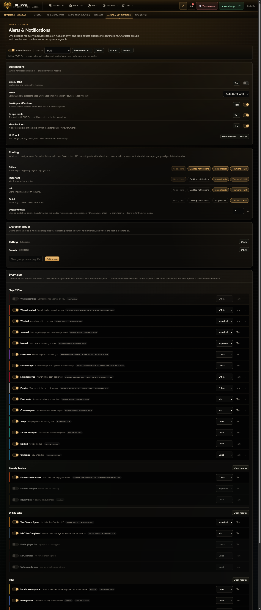

# Alerts

TNF Tools watches your game logs for things that matter and tells you about them. Every module
raises its alerts through one pipeline, so there is one place to decide what you hear and see.

**Settings → Alerts & Notifications** lists everything. Each module's own **Notifications** page
shows just that module's alerts; editing either edits the same setting.

## How an alert reaches you

1. Something happens in a log: you are scrambled, a site finishes, a payout lands.
2. The alert for it has a **priority**: Critical, Important, Info or Quiet.
3. The **routing** table says which **destinations** each priority uses.

So you never set "speak this, toast that" per alert. You say how important an alert is, and
separately what each level of importance does.

### Destinations

| Destination | What it is |
|---|---|
| **Voice / tone** | Spoken text, or a tone, on this computer. **Voice** picks which Windows voice speaks |
| **Desktop notifications** | Windows banners, visible while the app is in the background |
| **In-app toasts** | A toast inside the TNF Tools window |
| **Thumbnail HUD** | A coloured border, tint and chip on that character's [Multi-Preview](multi-preview.md#the-thumbnail-hud) thumbnail |

Each destination has a master switch and a **Test** button. Every alert is recorded in the
notification log whatever the destinations are.

The voice button in the top bar switches **Voice / tone** off and on without opening this page.

### Routing

One row per priority, with a chip for each destination. Click a chip to switch that destination
on or off for that priority.

| Priority | Intended for |
|---|---|
| **Critical** | Something is happening to your ship right now |
| **Important** | Worth interrupting you for |
| **Info** | Worth knowing, not worth shouting |
| **Quiet** | Visual only: paints a thumbnail, and never speaks or toasts |

**Digest window** merges identical alerts from several characters that arrive within that many
seconds into one announcement ("Drones under attack — 3 characters"). Set it to 0 to deliver
each one at once.

## Each alert

Every row has a switch, a priority, a **Test** button, and expands to show:

- the text that is spoken, which can include the character's name,
- which characters it applies to,
- how it paints a thumbnail: colour, effect, and how long it stays.

Some alerts have their own timing, for example how long drones may be idle before
**Drones: Stopped** fires.

### Ship and pilot

| Alert | Fires when |
|---|---|
| **Warp scrambled** | Something has a scram on you |
| **Warp disrupted** | Something has a point on you |
| **Webbed** | A stasis webifier is on you |
| **Jammed** | Your targeting systems have been jammed |
| **Neuted** | Your capacitor is being drained by someone else |
| **Decloaked** | Something decloaks near you |
| **Dreadnought** | A dreadnought NPC appears in your combat log |
| **Ship destroyed** | Your ship has been destroyed |
| **Podded** | Your capsule has been destroyed |
| **Fleet invite** | Someone invited you to a fleet |
| **Convo request** | Someone wants to talk to you |
| **Jump** | You jumped to another system |
| **System changed** | Local reports a different system |
| **Docked** | You docked |
| **Undocked** | You undocked |

Scram, point and web alerts fire only when they are aimed at you.

### Bounty Tracker

| Alert | Fires when |
|---|---|
| **Drones: Under Attack** | NPCs are attacking your drones |
| **Drones: Stopped** | Your drones have been idle for too long |
| **Bounty tick** | A bounty payout landed |

### DPS Master

| Alert | Fires when |
|---|---|
| **True Sansha Spawn** | You hit a True Sansha NPC |
| **NPC Site Completed** | No NPC took damage for a while after three or more were hit |
| **Under player fire** | A player is shooting you |
| **NPC damage** | An NPC is shooting you |
| **Outgoing damage** | You are shooting something |

### Intel

These need the optional [Intel](intel.md) module.

| Alert | Fires when |
|---|---|
| **Local roster captured** | A Local member list was captured for a character |
| **Intel queued** | A report is waiting to be sent |
| **Intel send failed** | A report could not be delivered |
| **Intel channel: neutral nearby** | An intel channel reports a confirmed neutral within your jump range |

## Character groups

A group is a named set of characters, defined once. It is used for:

- who an alert applies to,
- the resting border colour of those characters' thumbnails,
- where the group is meant to be, so a character away from it can be marked "split".

## Profiles

A profile is the whole set of alert settings under one name. The bar at the top of the page
switches profile, saves the current settings as a new one, and exports or imports a profile as
a file, so you can keep different setups for different activities or share one.

Every change you make is saved into the profile that is selected.

**All notifications** at the left of the bar switches the whole pipeline off and on.

## Notification log

The bell in the top bar, and the log at the bottom of this page, list recent alerts with the
time, the character and the system. The log can be filtered by module.
