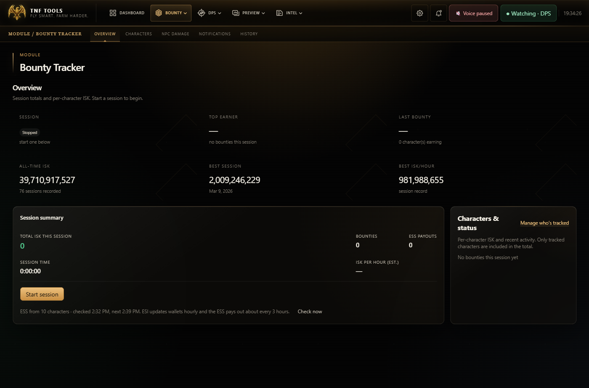
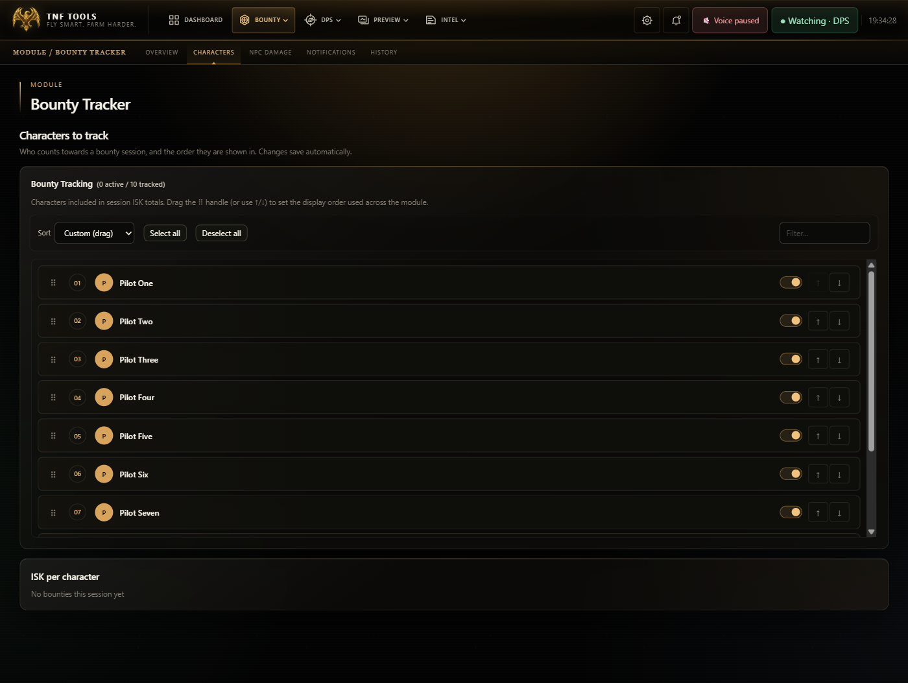
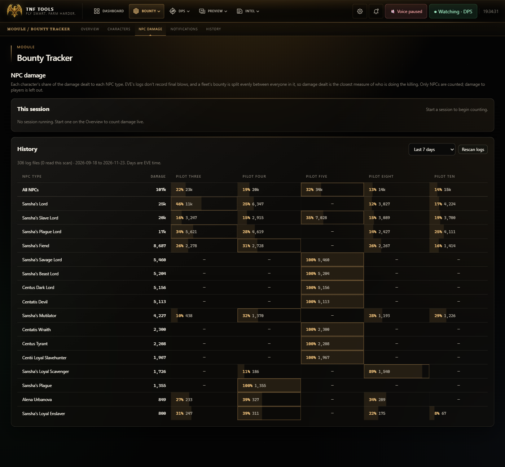

# Bounty Tracker

Tracks the ISK your characters earn from bounties, live, from the game's own log files.

## Sessions

A session is a stretch of ratting with a start and an end. While one is open, every bounty
payout written to a tracked character's game log is added to it.

1. Open **Bounty → Overview**.
2. Choose **Start session**.
3. When you finish, choose **Stop session**. The session is saved to History.

A session that is open when the app closes is picked up again the next time it starts, without
counting anything twice.

Starting and stopping a session is separate from the watch button in the top bar. Pausing there
pauses the session's log reading; the session stays open and its badge reads **Paused**.

## Overview

The six tiles at the top:

| Tile | Shows |
|---|---|
| **Session** | Live, Paused or Stopped, and how long it has run |
| **Top earner** | The character with the most ISK this session |
| **Last bounty** | When the last payout landed, and how many characters are earning |
| **All-time ISK** | Every recorded session added together |
| **Best session** | Your highest session total, and its date |
| **Best ISK/hour** | Your highest session rate |

**Session summary** shows the running total, the session time, the number of bounties, ESS
payouts, and an estimate of ISK per hour.

**Characters & status** lists each tracked character's ISK and recent activity.

### ESS payouts

If your characters are linked through EVE's sign-in (see
[Settings](settings.md#esi--characters)), main-bank payouts from the Encounter Surveillance
System are read from each character's wallet journal and shown beside the bounty total. They
are kept separate from it.

The wallet is checked about once an hour, and the ESS pays out roughly every three hours, so a
session also claims the payout that lands after it has ended. **Check now** forces a refresh.

## Characters to track

**Bounty → Characters.**

Switch each character on or off for session totals. Drag the handle, or use the arrows, to set
the order characters are shown in across the module. **Sort**, **Select all**, **Deselect all**
and **Filter** work on the list.

**ISK per character** underneath shows each character's share of the current session.

## NPC damage

**Bounty → NPC damage.** Each character's share of the damage dealt to each type of NPC.

EVE's logs do not record who landed a final blow, and a fleet's bounty is split evenly between
everyone in it. Damage dealt is therefore the closest measure of who is doing the killing. Only
NPCs are counted; damage to players is left out.

- **This session** counts live while a session is open.
- **History** is rebuilt from your saved log files. Choose a range (for example the last 7
  days) and **Rescan logs** to read them again.

Each cell shows a character's percentage of the damage to that NPC type and the amount. The
highest share in a row is outlined.

## Notifications

**Bounty → Notifications** lists the alerts this module raises:

- **Drones: Under Attack** — NPCs are attacking your drones.
- **Drones: Stopped** — your drones have been idle too long.
- **Bounty tick** — a bounty payout landed.

Each can be switched on or off, given a priority, and tested. What a priority does is set once
for the whole app; see [Alerts](alerts.md).

## History

**Bounty → History** lists every saved session with its start time, duration, total ISK and
ISK per hour.
