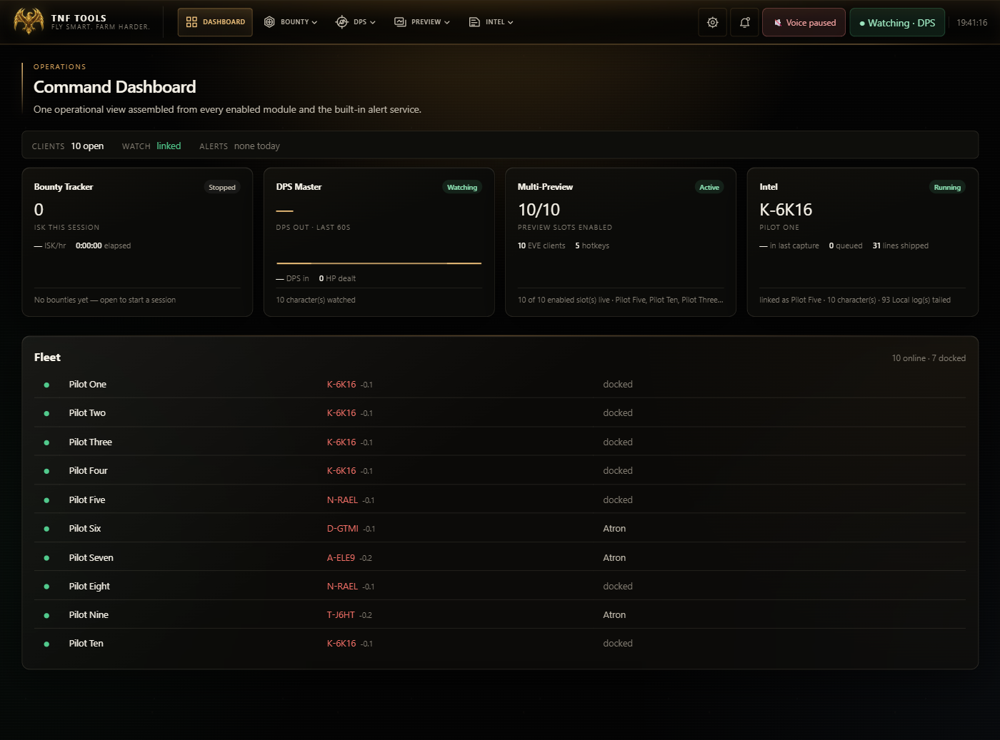

# Dashboard

The landing page: one view assembled from every module that is switched on.

## Status strip

The line under the heading summarises the app in three facts:

- **Clients** — how many EVE clients are open.
- **Watch** — whether the Intel module is linked to its server.
- **Alerts** — how many alerts have fired today.

## Module cards

One card per enabled module. Each shows that module's headline number and a status badge, and
clicking a card opens the module.

| Card | Shows | Badge |
|---|---|---|
| **Bounty Tracker** | ISK this session, ISK per hour, elapsed time, top earner | Live, Paused or Stopped |
| **DPS Master** | Damage per second out over the last 60 seconds, a sparkline, DPS in, total dealt | Watching, Paused or Idle |
| **Multi-Preview** | Enabled preview slots, running clients, slot hotkeys | Active or Idle |
| **Intel** | The focused character's system, the last capture, queued reports, lines shipped | Running, Paused, Queued, Not linked or Off |

The badges follow the same state as the watch button in the top bar. If you pause there, the
Bounty and DPS cards say Paused.

A card disappears when its module is switched off under **Settings → Modules**.

## Fleet

A row for each of your characters: whether they are online, the system they are in with its
security status, and the ship they are flying or **docked**.

The header counts how many are online and how many are docked.

Location, ship and online state come from EVE's ESI, so they need the character to be linked
under **Settings → ESI & Characters**. See [Settings](settings.md#esi--characters).
