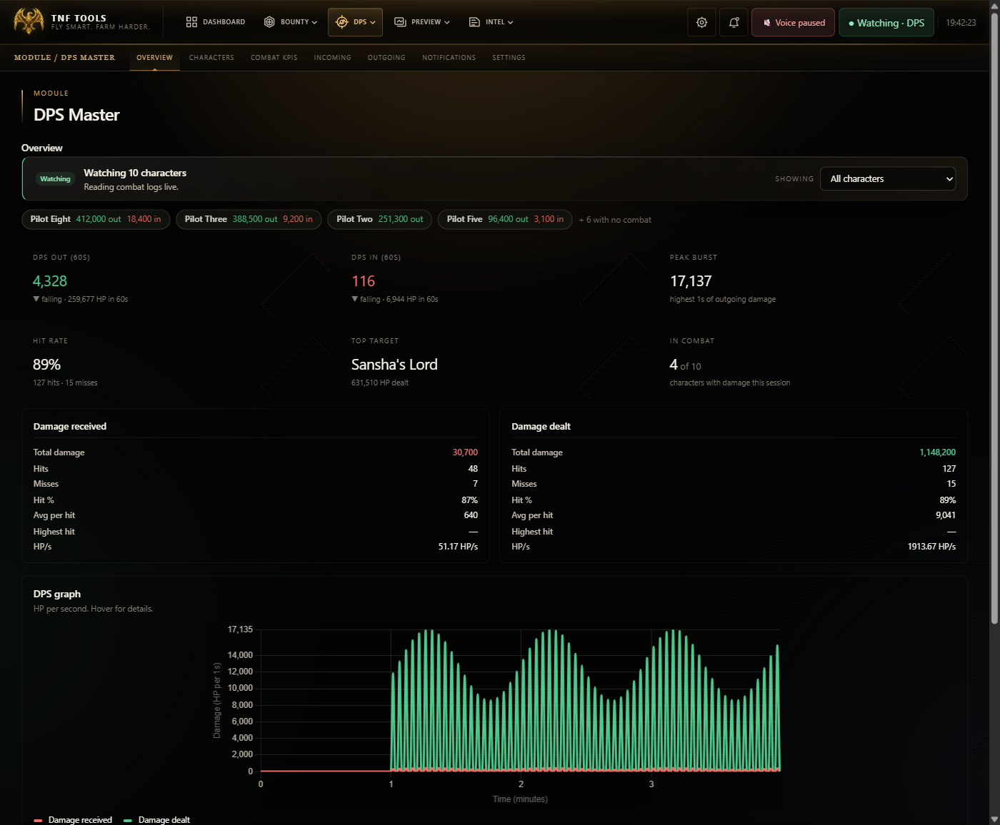
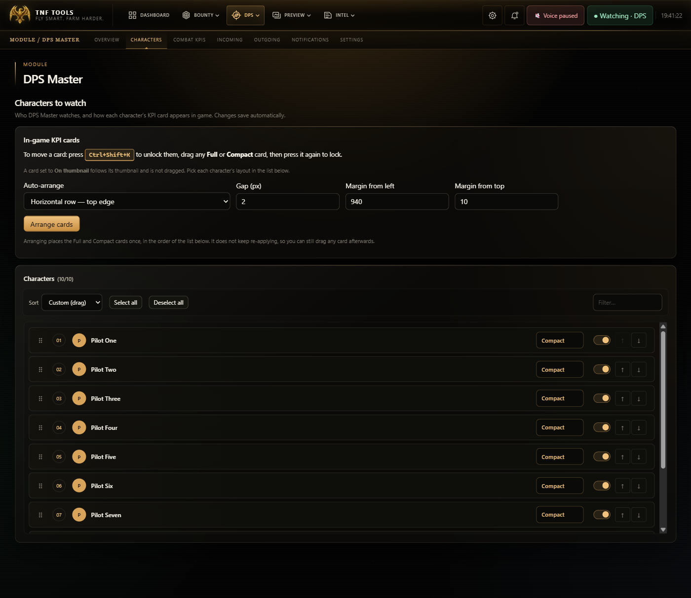
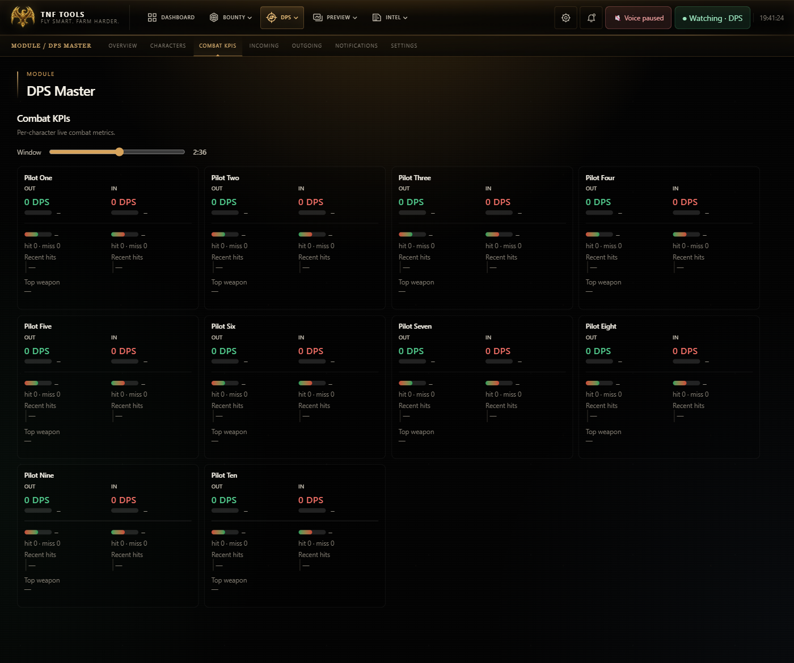

# DPS Master

Combat analysis from your game logs: damage dealt and received, how well your shots are
landing, who you are shooting and who is shooting you. It can also put a small card for each
character on screen over the game.

Watching is started, paused and resumed with the watch button in the top bar. See
[Getting started](getting-started.md#the-watch-button).

## Overview

### Status bar

The bar at the top says what state DPS is in (**Watching**, **Paused**, or **Idle**), how many
characters are selected, and whose numbers are on the page. **Showing** switches between all
characters and one.

### Character chips

Under the status bar, each character that has dealt or taken damage this session appears as a
chip, busiest first, with damage out in green and damage in in red. Click a chip to see only
that character; click it again to go back to everyone. Characters with no combat are collapsed
into a count.

### Tiles

| Tile | Shows |
|---|---|
| **DPS out (60s)** | Damage per second dealt over the last minute, whether it is rising or falling, and the total |
| **DPS in (60s)** | The same, for damage received |
| **Peak burst** | The highest single second of outgoing damage |
| **Hit rate** | Hits against misses, outgoing, for the whole session |
| **Top target** | What you have done the most damage to |
| **In combat** | How many of your watched characters have dealt or taken damage |

### Totals, graph and breakdowns

- **Damage received** and **Damage dealt** — total damage, hits, misses, hit percentage, average
  and highest hit, and HP per second.
- **DPS graph** — damage per second over time, in and out. **Window** sets how far back it
  shows, from 1 to 10 minutes; hover a point for what happened in that second.
- **Damage taken by source** and **Damage dealt by target** — one row per NPC or player, with
  totals, hits, misses and the weapons involved, for the chart window.

Until something has been hit, the totals and breakdowns are replaced by a line saying that no
combat has been recorded, and why (not started, paused, or simply quiet).

## Characters and the in-game KPI cards

**DPS → Characters.**

### Characters

The list underneath decides who DPS Master watches. Each row has:

- a **watch switch**,
- a **layout** for that character's in-game card: **Off**, **Full**, **Compact**, or
  **On thumbnail**,
- handles and arrows to set the order.

### In-game KPI cards

A transparent, always-on-top overlay can show a card per character over the game.

- **Full** is a card with damage out and in, trend bars, hit and miss counts, recent hit quality
  and the top weapon.
- **Compact** is a single line: the character's name, then damage out and damage in.
- **On thumbnail** pins the compact line to the top of that character's Multi-Preview
  thumbnail, so it moves with it.

Full and Compact cards are the same width, and show whole-number rates with room for four
digits each way.

**Moving a card.** Press the move hotkey (**Ctrl+Shift+K** by default; the panel shows the key
that is actually bound) to unlock the cards, drag any Full or Compact card, then press it again
to lock. While locked, the overlay ignores the mouse completely, so it never gets in the way of
the game.

**Auto-arrange** places the Full and Compact cards in one action, in the order of the list:

| Arrangement | Result |
|---|---|
| **Grid** | Rows of the number of **Columns** you set, starting from **From X / From Y** |
| **Vertical stack — left / right edge** | A column against that edge, with margins |
| **Horizontal row — top / bottom edge** | A row along that edge, with margins |

**Gap** is the space between cards. A line that is too long for the screen wraps into a second
one. Arranging happens once; you can still drag any card afterwards.

## Combat KPIs

**DPS → Combat KPIs** shows a card per character with live damage out and in, trend, hit and
miss counts, recent hits and top weapon. **Window** sets how many seconds the rates are
measured over.

## Incoming and outgoing damage

**DPS → Incoming damage** and **DPS → Outgoing damage** break one direction down in detail:

- headline numbers: total damage, hits, misses, hit rate, average per hit;
- **Hit quality** — how your hits are distributed across the game's hit grades;
- **By source** or **By target** — one row per attacker or victim;
- **Weapons** — damage by weapon.

## Notifications

**DPS → Notifications** lists the alerts raised from the combat log:

- **True Sansha Spawn** — you hit a True Sansha NPC.
- **NPC Site Completed** — no NPC took damage for a while after three or more were hit.
- **Under player fire** — a player is shooting you.
- **NPC damage** — an NPC is shooting you.
- **Outgoing damage** — you are shooting something.

See [Alerts](alerts.md) for priorities and where each alert is delivered.

## Settings

**DPS → Settings.**

- **Combat parsing** — switch off to stop recording damage here. The logs are still read, and
  bounty tracking and alerts are not affected.
- **In-game KPI overlay** — show or hide the overlay, its overall opacity, and the look of the
  cards: background colour, background transparency and text transparency.
