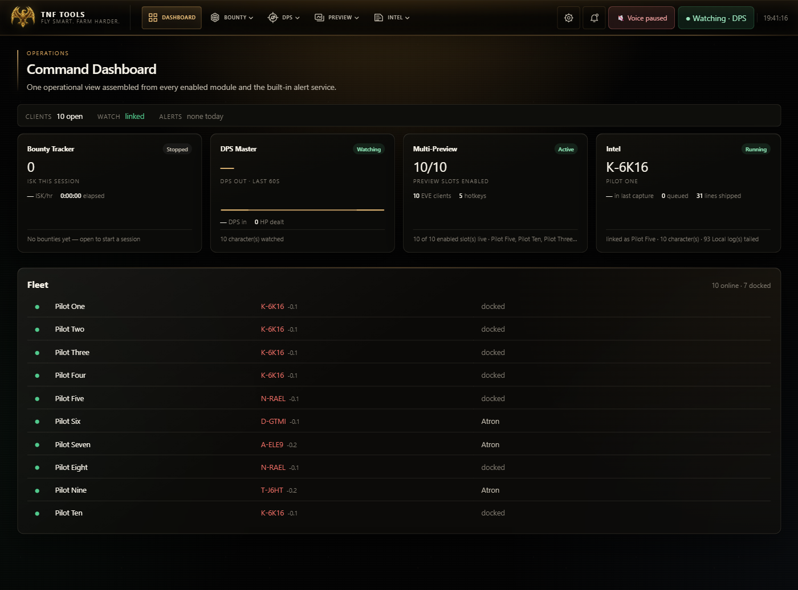
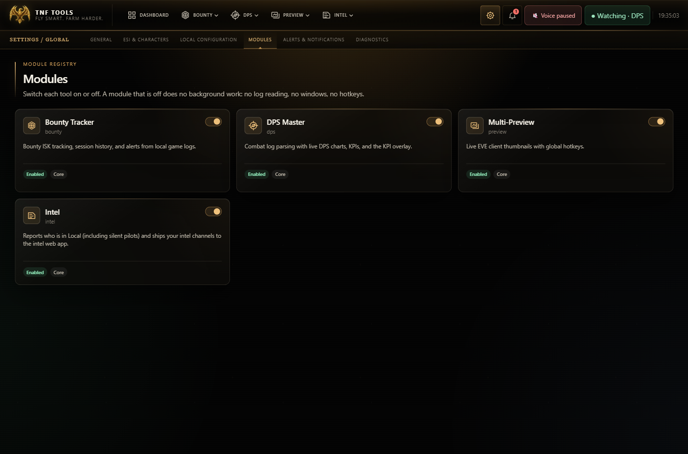

# Getting started

## Install

1. Download `TNF Tools_<version>_x64-setup.exe` from the
   [latest release](../../../releases/latest). There is a Windows 64-bit build only.
2. Windows SmartScreen shows **"Windows protected your PC — Unknown publisher"**, because the
   installer is not code-signed. Choose **More info**, then **Run anyway**.
3. To check the download before running it, compare its hash with the SHA-256 printed in the
   release notes:

   ```powershell
   Get-FileHash '.\TNF Tools_<version>_x64-setup.exe' -Algorithm SHA256
   ```
4. Run the installer. It installs for your Windows account only, into
   `%LOCALAPPDATA%\TNF Tools`, and needs no administrator prompt.

### Updates

The app checks for a newer version about 90 seconds after it starts and every six hours after
that. When one is found it is downloaded in the background and a button appears in the top bar;
the update installs the next time you restart the app. You can also check by hand under
**Settings → General**.

Every update is signed, and the app refuses to install one whose signature does not verify.

## Point it at your logs

Everything the app knows comes from EVE's own log files.

1. If a page stays empty, check in EVE's settings that logging to file is switched on (chat
   logging is under EVE's chat settings).
2. In TNF Tools, open **Settings → Local Configuration**. The **EVE log folder** is found
   automatically on first launch; it is usually
   `%USERPROFILE%\Documents\EVE\logs\Gamelogs`.
3. If the box is empty or wrong, choose **Browse** and pick the `Gamelogs` folder.

The chat-log folder (`Chatlogs`) is found beside it.

## The window



- **Top bar.** The module menus (Dashboard, Bounty, DPS, Preview, Intel), then on the right:
  Settings, the notification bell, the voice button, and the watch button.
- **Sub-bar.** The pages of whichever module you are in.
- **Closing the window** hides it to the system tray by default. The app keeps reading logs,
  showing previews and raising alerts. Use the tray icon's **Quit** to exit. This can be changed
  under **Settings → General**.

## The watch button

The button at the right of the top bar is the one control for log reading, and the one
statement of its state. Every other page shows the same state.

| It says | Meaning | Clicking it |
|---|---|---|
| **○ Not watching** | Nothing is reading the logs | Starts DPS watching for your selected characters |
| **● Watching · DPS** (or **Bounty**, or both) | Logs are being read for the named modules | Pauses everything |
| **Ⅱ Paused · DPS** | The modules are still on, but no logs are being read | Resumes |

A bounty session is started and ended on the Bounty page, because a session is a record with a
beginning and an end. See [Bounty Tracker](bounty-tracker.md).

## The voice button

Next to the watch button. It pauses and resumes spoken and tone alerts without touching
anything else: thumbnails still flash, toasts still appear, and the notification log still
records everything.

## Your first ten minutes

1. **Check the log folder** (above).
2. **Set up previews.** Open **Preview → Preview slots** and add a slot for each character.
   Thumbnails appear for any client that is running. See [Multi-Preview](multi-preview.md).
3. **Start watching.** Click the watch button. **DPS → Overview** fills in as your characters
   fight.
4. **Start a bounty session** on **Bounty → Overview** when you begin ratting.
5. **Tune the alerts.** **Settings → Alerts & Notifications** lists every alert. Switch off the
   ones you do not want and set the priority of the rest. See [Alerts](alerts.md).

## Which modules are on

**Settings → Modules** switches each tool on or off. A module that is off does no background
work at all. Bounty Tracker, DPS Master and Multi-Preview are on by default. Intel is off until
you turn it on; see [Intel](intel.md) for what it does and what it sends.


