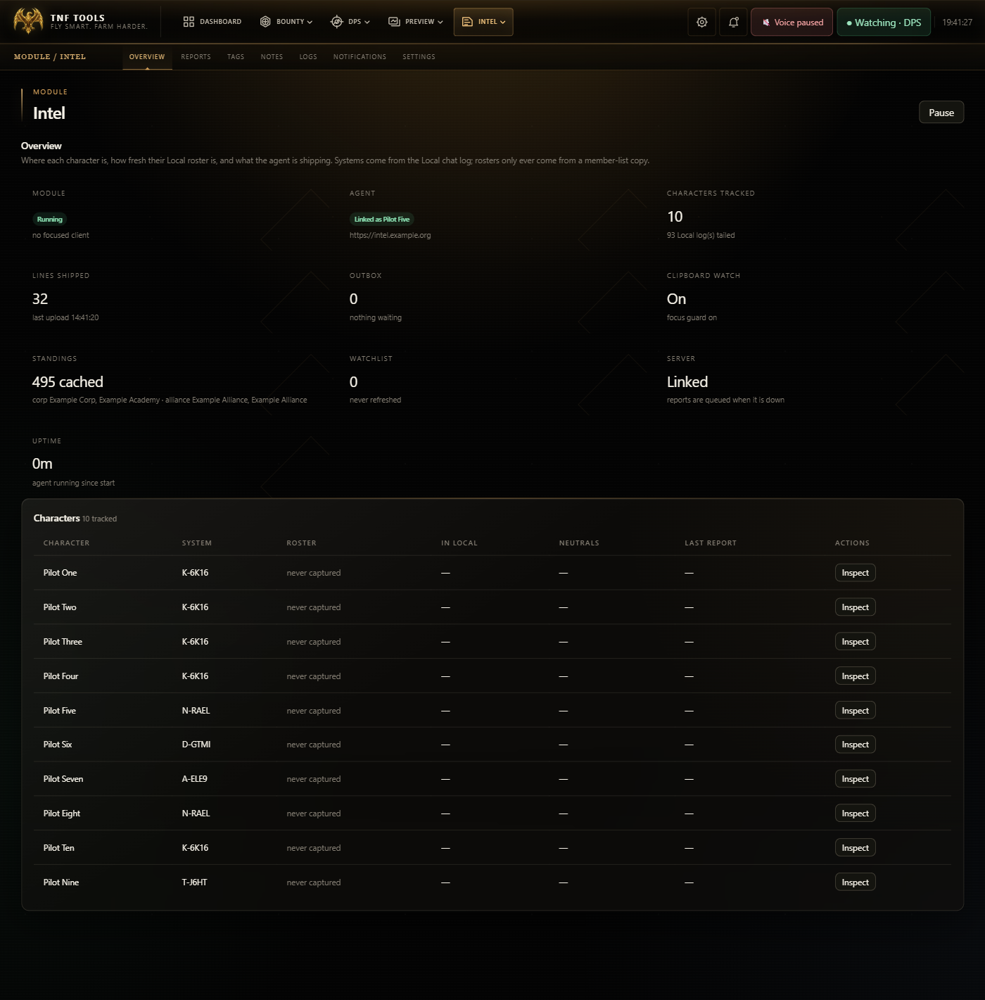
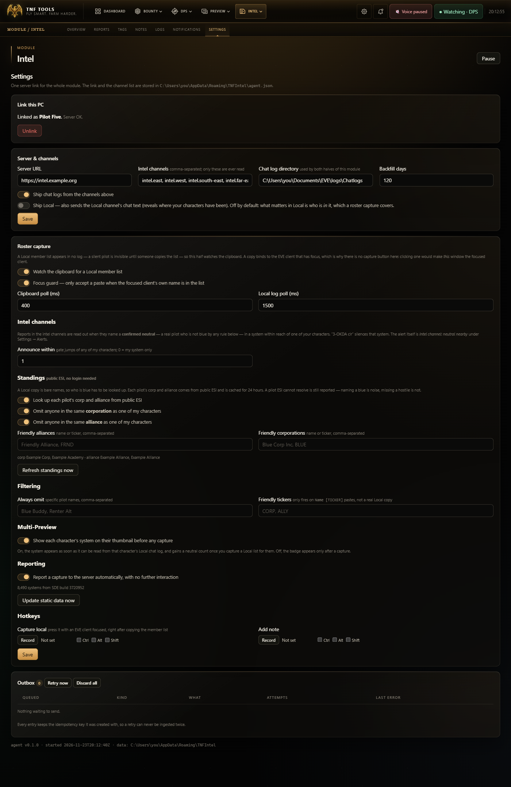

# Intel

An optional module for groups that share intel through a companion web server. It is **off by
default**, and it is the only module that sends anything about your game to another computer.
Read [Privacy and data](privacy.md) before turning it on.

Intel does two jobs:

- **Shares** what you already see: lines from the intel chat channels you choose, the Local
  member list when you copy it, and D-scans when you copy them.
- **Warns** you: it reads the intel channels and speaks up when a confirmed neutral is reported
  near one of your characters.

It needs a compatible server run by your corporation or alliance, and an account on it. Without
a link to a server the sharing half does nothing.

## Turning it on and linking

1. Switch **Intel** on under **Settings → Modules**.
2. Open **Intel → Settings**. Enter the **Server URL** your group gave you.
3. Choose **Link to server**. A browser tab opens on the server with a short code. Sign in there
   and approve the code.
4. The page shows **Linked as** your character. Everything the module sends is posted under that
   character.

**Unlink** removes the link from this computer. Anything already queued is kept.

## Overview

**Intel → Overview** shows the state of the module: whether it is running, who it is linked as,
how many characters it is tracking, lines shipped, the outbox, whether the clipboard watch is
on, how many standings are cached, the watchlist size, and the server link.

The **Characters** table has a row per character: the system they are in (read from their Local
chat log), when their Local roster was last captured, how many pilots and how many neutrals it
held, and the last report.

**Pause** at the top right stops the module sending and reading until you resume it.

## Local rosters

Who is in Local does not appear in any log: a pilot who never speaks is invisible until someone
copies the member list. So Intel watches the clipboard.

1. In EVE, click in the Local member list, press **Ctrl+A**, then **Ctrl+C**.
2. Intel recognises the copy, works out which names are not friendly, and reports them with the
   system, if **Report a capture to the server automatically** is on.

A copy is tied to the EVE client that has focus. The **focus guard** only accepts a copy when
that client's own character is in the list, which stops a list copied in one client being filed
under another.

A whole-list copy (Ctrl+A, then Ctrl+C) is treated as the complete roster of that system, so a
pilot missing from a newer copy is taken to have left. A partial selection only adds names.

### Who counts as friendly

A Local copy is bare names, so Intel has to work out who is blue. In order:

1. Your own characters, and anything on your **Always omit** list.
2. **Standings from your contacts**, if your characters are linked through EVE's sign-in:
   personal, corporation and alliance contacts.
3. **Corporation and alliance**, looked up on CCP's public ESI and cached for 24 hours: anyone
   in the same corporation or alliance as one of your characters, and any **Friendly
   alliances** or **Friendly corporations** you have listed.
4. The friendly list your server keeps, if it has one.

Anyone none of these can place is reported as a neutral, marked "standing unknown". Naming a
blue is noise; missing a hostile is not.

**Intel → Reports** shows the last capture: who was reported, and for everyone filtered out,
the rule that filtered them.

## Intel channels

Intel reads the chat channels you list under **Intel channels** in Settings. Only those
channels are read.

- With **Ship chat logs from the channels above** on, new lines are sent to your server.
- A line is **read out** when it names a confirmed neutral (a real pilot who is not friendly by
  the rules above) in a system within reach of one of your characters. The announcement names
  your nearest character and the system.
- **Announce within** sets the reach, in gate jumps. 0 means your own system only.
- A "clr" for a system in the channel silences it.

**Ship Local** also sends the Local channel's chat text. It is off by default, because it
reveals where your characters have been.

**Backfill days** is how far back the module sends channel history the first time.

## D-scans

Copy a D-scan in EVE (Ctrl+A, Ctrl+C in the directional scanner window) and it is uploaded with
the focused character's system. Copy Local within two minutes and the two are joined into one
report.

The newest scan's link is shown on **Intel → Reports** with a **Copy link** button, ready to
paste wherever you want it.

## Tags and notes

- **Intel → Tags.** Mark a pilot **friendly**, **hostile** or **ignore for now** (with an expiry
  in minutes). Marks change how future captures are filtered on this computer, and are mirrored
  to your server. A hostile mark always wins over the friendly rules.
- **Intel → Notes.** Write a note, optionally about named pilots and a system, and optionally
  attached to your last report.

## Reports, logs and the outbox

- **Intel → Reports** — the last D-scan, the last capture, and recent reports with their status.
- **Intel → Logs** — the state of the chat-log shipper and the module's activity feed.
- **Outbox** (in Settings) — reports waiting to be sent. If the server cannot be reached,
  reports are queued on disk and retried, so nothing is lost while it is down. Each report is
  sent at most once however many times it is retried.

## Settings

| Section | Settings |
|---|---|
| **Link this PC** | Link and unlink |
| **Server & channels** | Server URL, intel channels, chat-log folder, backfill days, ship chat logs, ship Local |
| **Roster capture** | Watch the clipboard, focus guard, how often the clipboard and the Local log are checked |
| **Intel channels** | How many jumps away a report is announced |
| **Standings** | Public ESI lookup, omit own corporation, omit own alliance, friendly alliances and corporations, refresh |
| **Filtering** | Always omit, friendly tickers |
| **Multi-Preview** | Show each character's system on their thumbnail before any capture |
| **Reporting** | Report captures automatically; update the star-system data |
| **Hotkeys** | Capture Local, add note |

## Notifications

**Intel → Notifications** lists this module's alerts; see [Alerts](alerts.md#intel).
