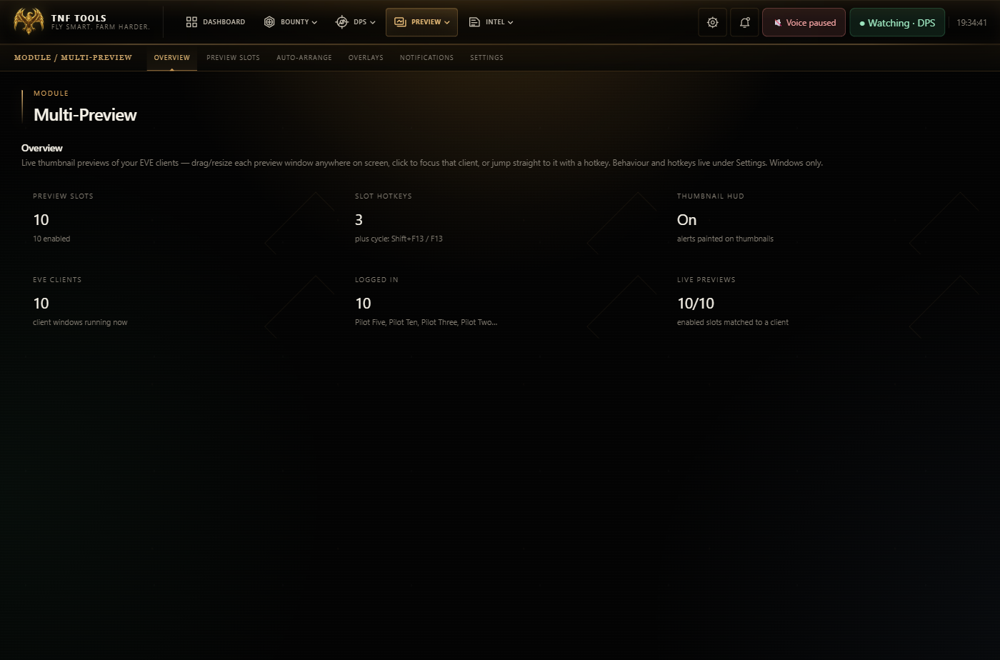
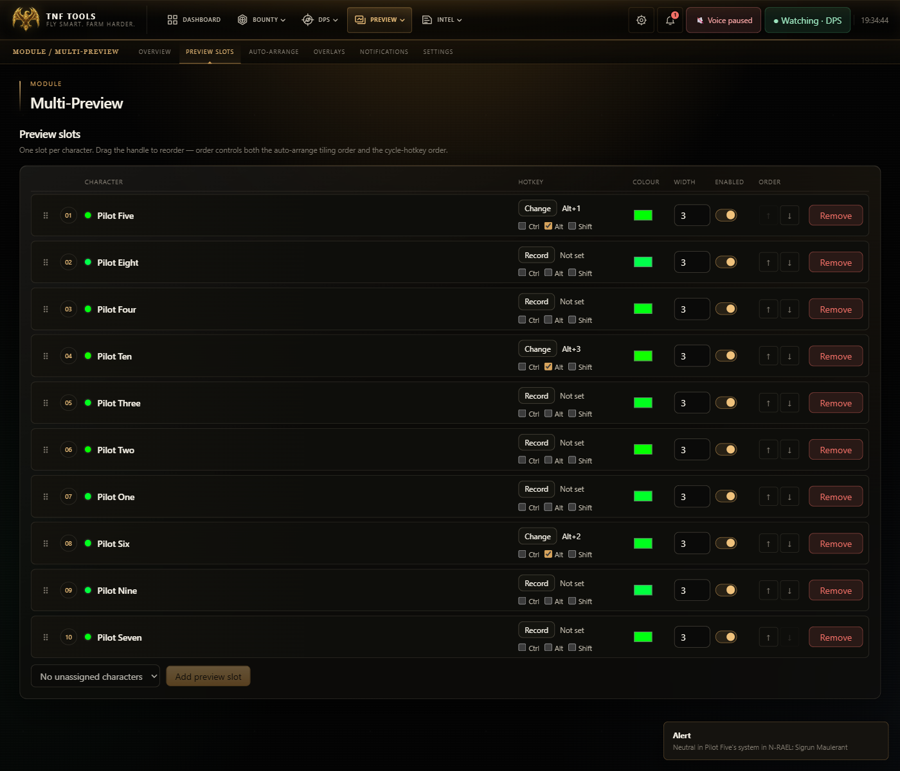
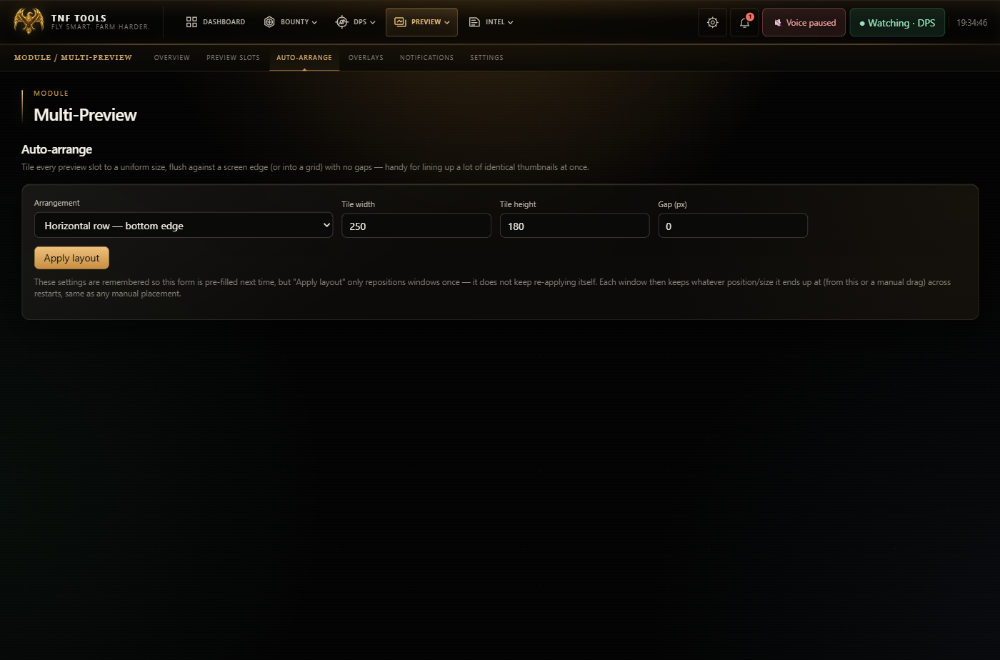
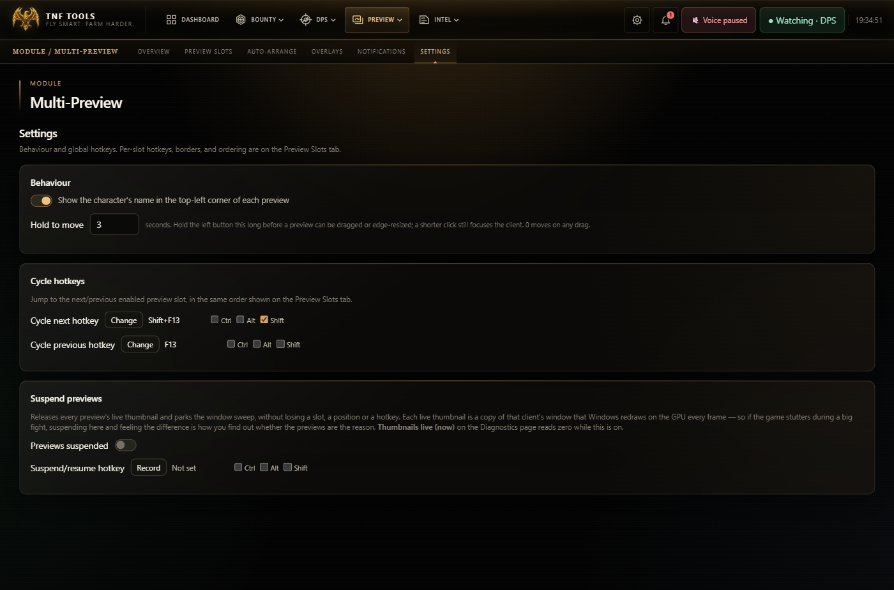
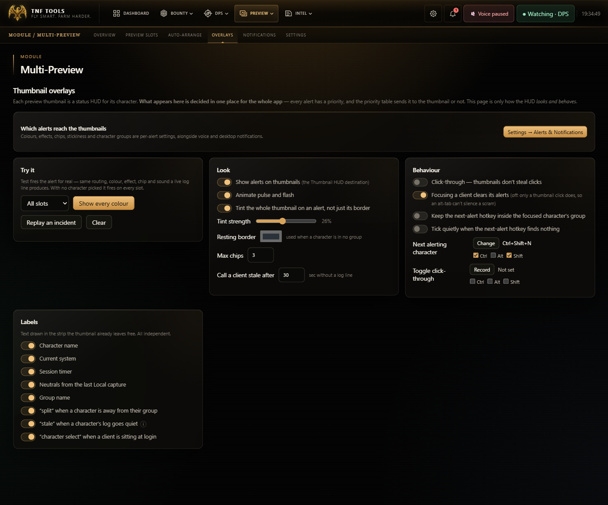

# Multi-Preview

A small live window for each EVE client. Click one to bring that client to the front, or give
it a hotkey. The thumbnails also act as a status display: see [the thumbnail HUD](#the-thumbnail-hud).

The previews use Windows' own thumbnail compositor. They are a live view, not a recording:
nothing is captured, saved or sent anywhere.

## Overview

**Preview → Overview** shows how many slots you have and how many are enabled, how many slot
hotkeys are set, whether the thumbnail HUD is on, how many EVE clients are running, who is
logged in, and how many enabled slots are currently matched to a client.

## Preview slots

**Preview → Preview slots.** One slot per character. A slot shows a thumbnail whenever that
character's client is running; when a client restarts, its preview comes back by itself.

| Column | What it does |
|---|---|
| **Drag handle** and **Order** arrows | Reorder the slots. The order is used by auto-arrange and by the cycle hotkeys |
| **Character** | The character the slot follows. The dot is green while its client is running |
| **Hotkey** | **Record** a key, then tick **Ctrl**, **Alt** or **Shift**. Pressing it focuses that client from anywhere |
| **Colour** | The highlight border drawn on the preview of the client that currently has focus |
| **Width** | The width of that border, in pixels |
| **Enabled** | Hides the preview without deleting the slot |
| **Remove** | Deletes the slot |

To add a slot, pick a character from the list under the table and choose **Add preview slot**.
Characters appear in the list once the app has seen them in your logs.

## Using the previews

- **Click** a preview to focus that client.
- **Hold, then drag** to move a preview. Hold the left button for the hold time (3 seconds by
  default); the cursor changes while you hold and again when the preview comes loose. A shorter
  press is treated as a click, so focusing a client never nudges its preview.
- **Hold near an edge, then drag** to resize.
- **Right-drag an edge** to resize every preview to the same size at once.

Each preview remembers its position and size between runs.

## Auto-arrange

**Preview → Auto-arrange** tiles every slot to one size in one action.

| Setting | Meaning |
|---|---|
| **Arrangement** | Vertical stack on the left or right edge, horizontal row along the top or bottom edge, or a grid |
| **Columns** | Grid only |
| **Tile width / height** | The size of each preview. For a grid, the two are used as an aspect ratio and the size is worked out from the columns |
| **Gap** | Space between previews, in pixels |

**Apply layout** places the windows once. It does not keep re-applying, so you can still move
any preview afterwards. The form remembers your values.

## Settings

**Preview → Settings.**

- **Show the character's name** in the top-left corner of each preview.
- **Hold to move** — how many seconds the left button must be held before a preview can be
  dragged or resized. Set it to 0 to move on any drag.
- **Cycle hotkeys** — jump to the next or previous enabled slot, in slot order.
- **Suspend previews** — releases every thumbnail without losing a slot, a position or a hotkey.
  Each live thumbnail is redrawn by Windows every frame, so if the game stutters in a large
  fight, suspending them is the way to find out whether the previews are the cause. There is a
  hotkey for it.

## The thumbnail HUD

**Preview → Overlays.** Each preview doubles as a status light for its character. When an alert
fires for a character, its preview can change border colour, pulse, tint, and show a short chip
of text.

Which alerts reach the thumbnails, and in what colour, is decided with every other alert
setting on **Settings → Alerts & Notifications**. This page controls only how the HUD looks and
behaves. See [Alerts](alerts.md).

### Look

- **Show alerts on thumbnails** — the master switch for the HUD.
- **Animate pulse and flash.**
- **Tint the whole thumbnail** on an alert rather than just its border, with a **tint strength**.
- **Resting border** — the border colour of a character that is in no group.
- **Max chips** — how many text chips a preview can show at once.
- **Call a client stale after** — seconds without a log line before a preview is marked stale.

### Behaviour

- **Click-through** — previews ignore the mouse entirely, so clicks pass to whatever is behind
  them. With this on you switch clients with hotkeys only. There is a hotkey to toggle it.
- **Focusing a client clears its alerts.**
- **Keep the next-alert hotkey inside the focused character's group.**
- **Tick quietly when the next-alert hotkey finds nothing.**
- **Next alerting character** — a hotkey that jumps to the client with the most urgent alert.

### Labels

Text drawn in the strip at the top of each preview. Each is independent:

- Character name
- Current system
- Session timer
- Neutrals from the last Local capture (needs the [Intel](intel.md) module)
- Group name
- "split" when a character is away from the rest of its group
- "stale" when a character's log goes quiet
- "character select" when a client is sitting at login

### Try it

Fire a test alert at one slot or all of them, show every colour, or replay a recorded incident,
to see what your settings look like without waiting for the real thing.
