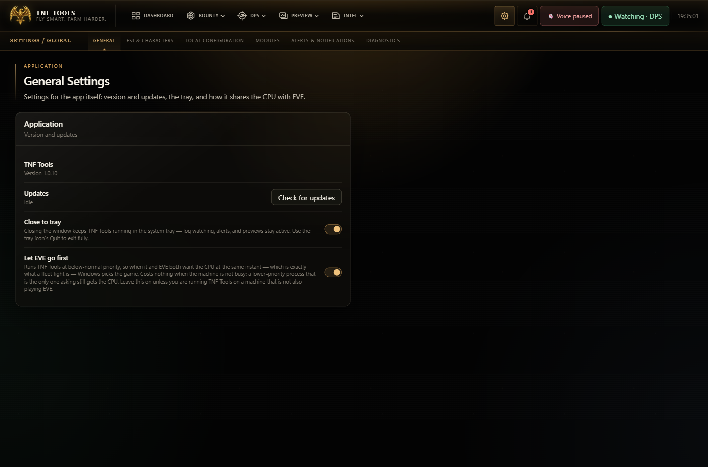
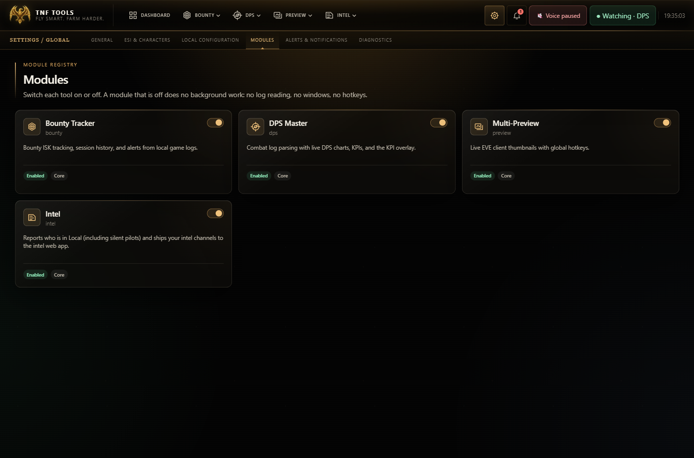
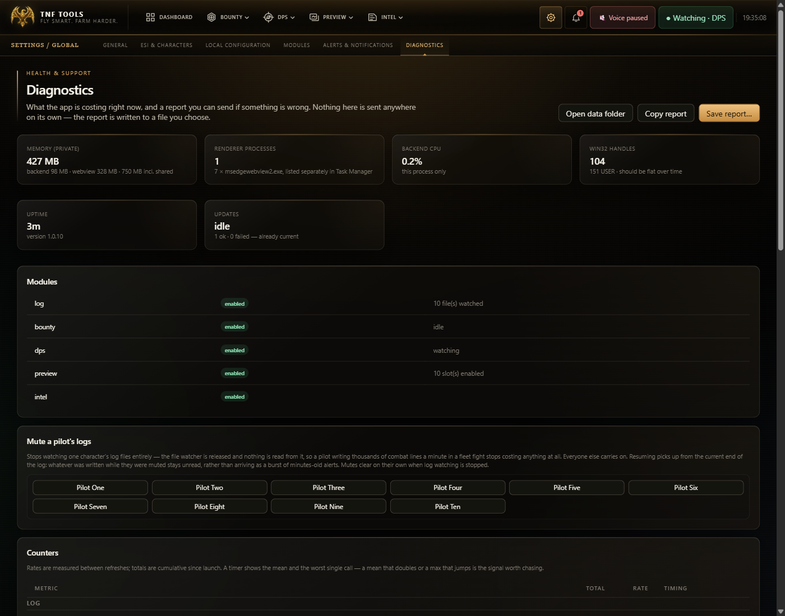

# Settings

The gear in the top bar. Each module also has its own settings page inside its menu; this is
for the app as a whole.

## General

- **Version** and **Updates** — the installed version, and a manual update check. Updates are
  normally found and downloaded in the background; see
  [Getting started](getting-started.md#updates).
- **Close to tray** — closing the window keeps the app running in the system tray, so log
  reading, alerts and previews carry on. Use the tray icon's **Quit** to exit. On by default.
- **Let EVE go first** — runs TNF Tools at below-normal priority, so when it and EVE want the
  processor at the same moment, Windows picks the game. It costs nothing when the machine is
  not busy. Leave it on unless you run the app on a computer that is not also running EVE.

## ESI & Characters

Characters are discovered from your game logs with no sign-in at all. Linking a character
through EVE's own sign-in adds live data for it.

- **Scan local logs** — look for characters in the log folder again.
- **Connect ESI account** — opens EVE's sign-in page in your browser. You choose the character
  and approve the access there.

The table lists every character with how it was found, whether it is linked, and its location.
**Unlink** removes a character's link.

Linking is used for:

| What | Used by |
|---|---|
| Location, ship and online state | The dashboard's fleet table |
| Wallet journal | ESS payouts in Bounty Tracker |
| Personal, corporation and alliance contacts | Telling friendly pilots from neutrals in Intel |
| Setting a waypoint | Waypoints sent from a companion intel site |
| Assets and structure names | Asset lookups |

The sign-in token is stored in the Windows credential store, not in a settings file. You can
revoke access at any time from your EVE account's third-party applications page. Details are in
[Privacy and data](privacy.md).

## Local configuration

- **EVE log folder** — the `Gamelogs` folder the app reads. Found automatically on first launch;
  **Browse** to change it.

These settings never leave this computer.

## Modules

Switch each tool on or off: Bounty Tracker, DPS Master, Multi-Preview, Intel. A module that is
off does no background work: no log reading, no windows, no hotkeys. Its menu and its dashboard
card disappear.

## Alerts & Notifications

Every alert, the priority routing, voices, character groups and profiles. See
[Alerts](alerts.md).

## Diagnostics

What the app is costing right now, and a report you can send if something is wrong.

- **Tiles** — memory, the number of browser-engine processes the app owns, processor use,
  window handles, uptime, and the state of the updater.
- **Modules** — which modules are active and what each is doing.
- **Mute a pilot's logs** — stop reading one character's log files entirely. Useful when one
  character in a large fight is writing thousands of combat lines a minute. Everyone else
  carries on. Unmuting picks up from the current end of the log, so there is no burst of old
  alerts.
- **Counters** — detailed counts and timings per module, for tracking down a slowdown.
- **Open data folder**, **Copy report**, **Save report** — the report is written to a file you
  choose. Nothing is sent anywhere by the app.

**Before you send a report to anyone, open it.** It names your characters and the systems they
were in, and includes the end of the application log. Your Windows user name is removed from
file paths.
